# Teche · reports

## 2026-11-09, Vibe Card quiz removed from the welcome page: #76 live

On Kamal's word, the quiz card is gone from the welcome page, so sign-in comes up first. On a phone, the sign-in
card now starts about a third of the way down the first screen, with all three choices visible. Sign-in itself is
unchanged. The quiz still works from links and from Account. Merged and published: the website runs NavigateMe
6a14257, and Android users get it by reinstalling.

## 2026-11-09, #75 is live: database first, then the website

Kamal merged #75. I applied schema.sql at 88e31bc to the live database (md5 ab06264c…, matching the file on
GitHub), then published the website after the Android build for the merge finished.

**Checked on the live database:**
- every profile has an active date;
- nobody is phone-verified yet, which is correct while sign-in uses the test code;
- the 30-day check can't be called from the app;
- a real seeker still sees all 104 active homes (rolled back).

**After review (King), the "Phone verified" tick follows a server flag.** That flag is set only when a code was
actually delivered to the phone. So no ticks show today, and they turn on by themselves when real WhatsApp/SMS
codes go live. This includes the tick next to the owner's name after a request is accepted, which used to show
for everyone.

Android users get these changes by reinstalling the app.

## 2026-11-09, competitor research, six ideas built: PR #75 (not merged); #74 is live

**#74 (alignment) is live.** Kamal merged it and I published the website, which now runs NavigateMe cac03e3.

**Research.** I compared 99acres, Housing, NoBroker, Magicbricks, Flatmate.in, Stanza, SpareRoom, Flatmates.com.au
and Roomster. The session couldn't open their sites, so this comes from reviews, store write-ups and case studies.

**Built on Kamal's word ("build all 6"): PR #75.**
- A phone-verified tick on homes and people (never on samples).
- One-tap dealbreaker filters, each with a count.
- "Active 2 days ago" on homes. Homes whose owner is away 30 days leave Discover. This needs a database change,
  which goes live before the app.
- A never-pay-before-you-visit warning on a home's page.
- At most one prompt on Discover.
- Photo first with the score on the photo was already how cards look.

All suites pass, including the new p12, and 97 database checks pass.

| Discover with quick filters | Safety note on a home |
|---|---|
| 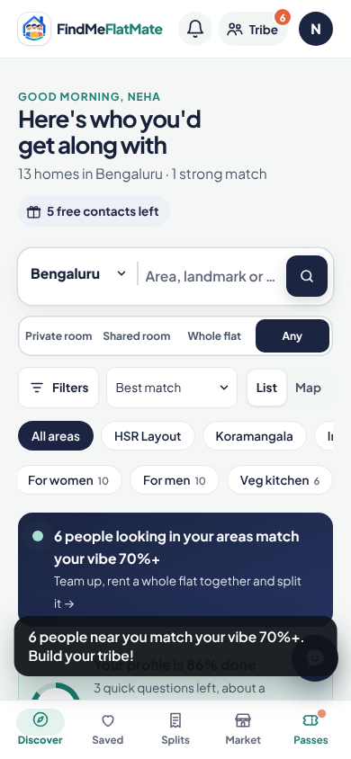 | 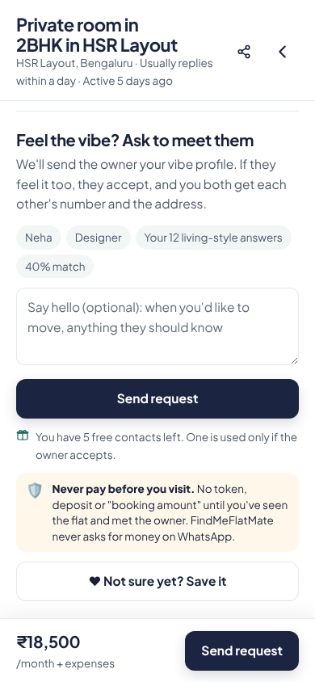 |

## 2026-11-09, alignment pass: PR #74 (not merged); compromise fix is live

**Compromise fix is live.** Kamal merged #72. I published the website, and it now runs NavigateMe de9e967, which
includes the fix. The Android app has it from today's build; reinstall to get it.

**Alignment.** I screenshotted every screen at 360, 390 and 412 wide: signed out, as a seeker and as an owner,
21 screens in all. An automatic check found nothing running off the screen. By eye I found six misses, fixed with one
commit per screen and the look unchanged:
- **Discover:** the city name was cut off by the phone's dropdown arrow ("Bengalurı").
- **A home's page:** the price bar left "expenses" alone on a line.
- **Welcome:** "Get the app" wrapped onto two lines, and the three skyline pills overlapped.
- **Splits:** "House parties near you" squeezed its text to a word per line.
- **Account:** the flatmate-type emoji took a third of the box, and "See parties" broke across two lines.
- **Posting form:** the third step read "Priva…".

All demo suites pass. Each picture is before (left) and after (right) at 360 wide:

| Discover | A home's page | Welcome |
|---|---|---|
| 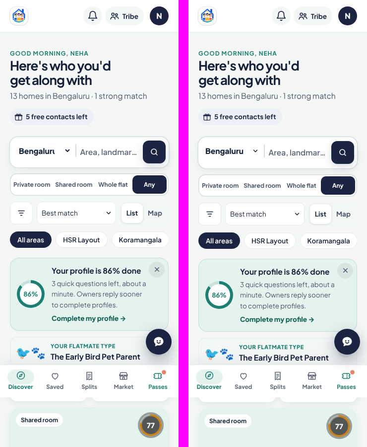 | 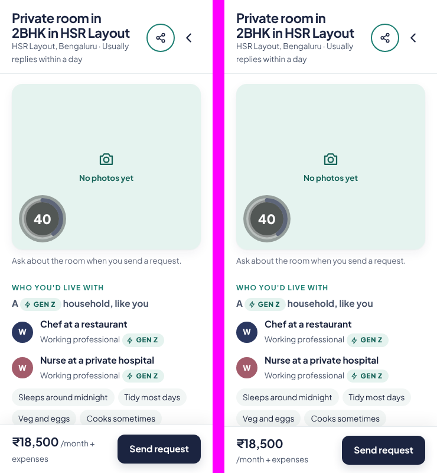 | 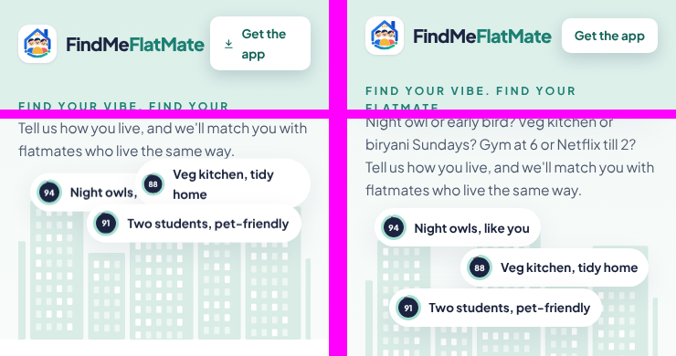 |

| Splits | Account | Posting form |
|---|---|---|
| 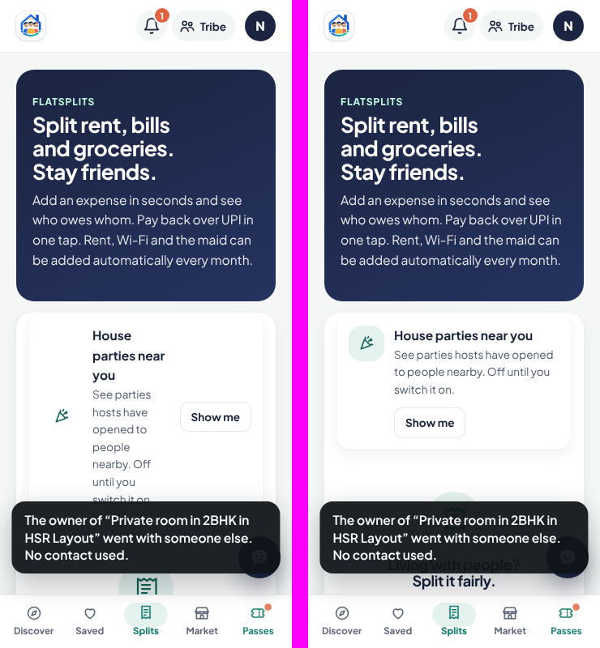 | 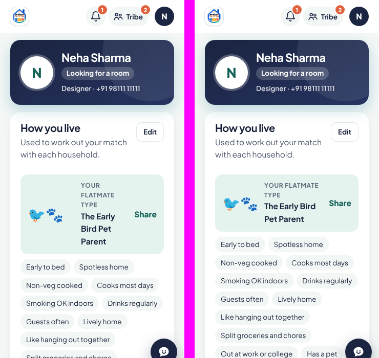 | 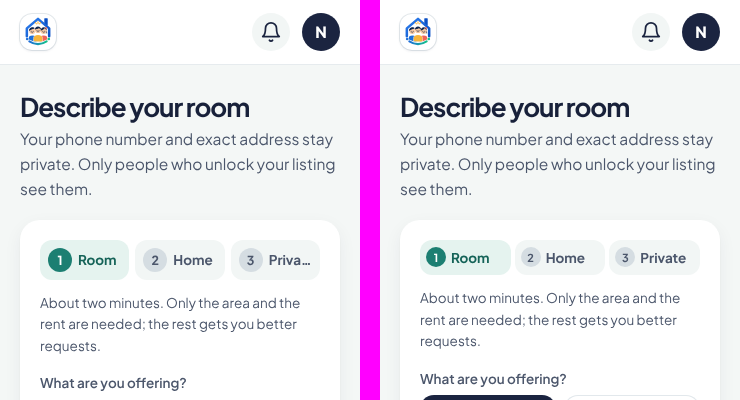 |

## 2026-11-09, compromise button fixed: PR #72 (not merged)

**Fault found.** On Requests, "Compromise and ask again" showed on every declined request, including whole flats
nobody lives in yet. Those homes have no household answers, so the screen opened empty: 0 → 0, nothing to change,
and a grey Send button that could never work. The button on a home's own page was already right.

**Fix.** The list now shows the button only when there's something to adjust, and the screen never opens empty or
twice for the same home. No database change.

**Checked:**
- A new test suite (p11) runs the whole flow at three phone sizes: the button is tappable, not under the bottom bar or
  the help button; the score rises live; Send works once; the owner sees "Ready to compromise · 40% → 43%".
- All suites pass: 272 checks.
- The live database check was rolled back, so nothing was saved. The server rules already worked: 67% → 73%, and the
  owner sees it.

| Before: the empty screen | After: Requests | After: the screen | After: owner sees |
|---|---|---|---|
| 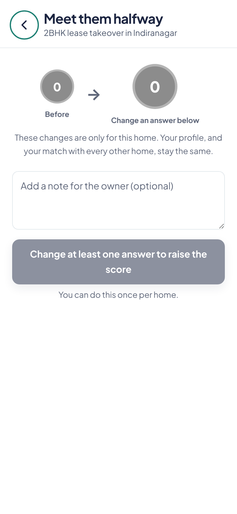 | 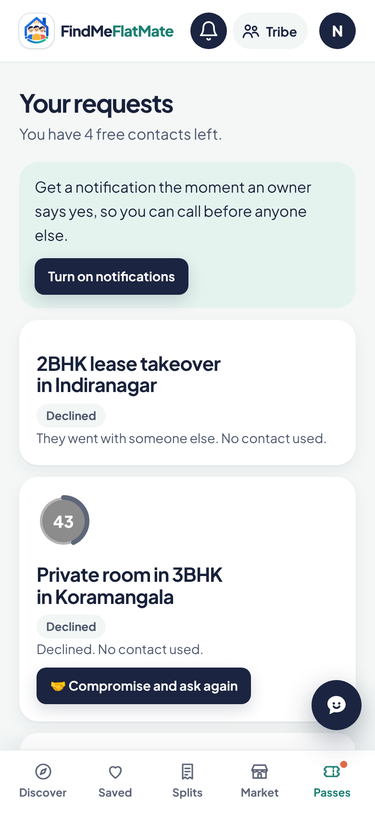 | 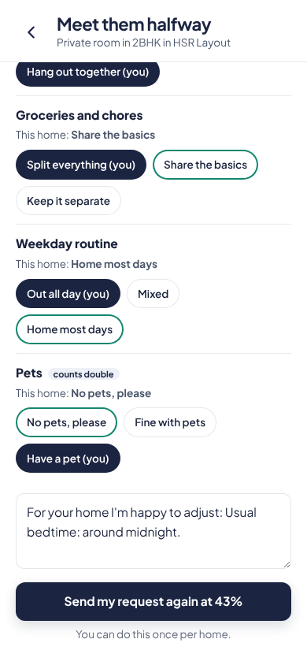 | 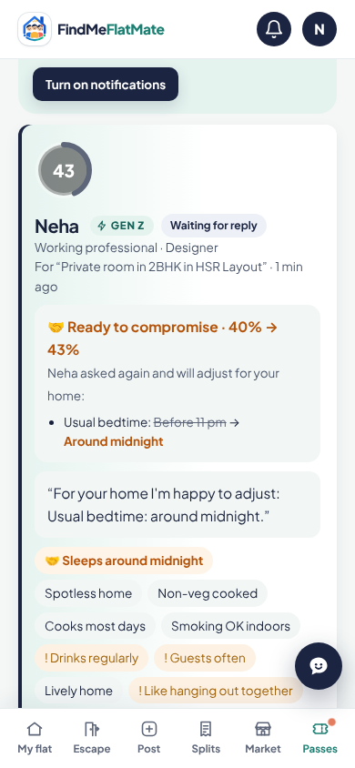 |

**Next:** the alignment pass, as a separate PR.

## 2026-11-09, website publishing: access, #69 published, stall fix PR

**Done.** On Kamal's word ("give yourself access to findmeflatmate") this session attached the website repo with push
access.
- I ran the publish job by hand: gh-pages is at NavigateMe 2f23eee, so #68 and #69 are on findmeflatmate.com.
- The same run copied the newest Android build to the download link.

**Why it stalled:** the `*/30` schedule fired only every 4 to 8 hours. GitHub runs scheduled jobs on a best-effort
basis and drops many at :00 and :30.

**Fix: findmeflatmate PR #1.** Merged on Kamal's word (74fb174); a test run on it succeeded.
- NavigateMe can trigger a publish directly. This needs Kamal to make one token and save it as a NavigateMe secret;
  the README in that repo has the steps.
- The fallback schedule moves to :17 and :47.

**Until then:** I run the publish job after each NavigateMe merge that changes flatmates/.

## 2026-11-09, reel clips for nearby parties: PR #71 (not merged)

Five demo-mode clips for Mark's reel are in `design/reel-nearby-parties/`: host opens, guest finds, request, host
accepts, guest unlocks. Each is MP4 at 720×1280, 4 to 6 seconds, with sample data only and a fake phone number.
No app change. **Updated:** free parties only, with no chip-in anywhere on screen (Kamal via King).

**#69 ship check (King's list, 9 Nov):**
- Database applied first and verified. #69 merged at 02:13; the Android build with it succeeded at 02:19.
- Live check, rolled back: a new Flatsplits-only account gets seekers-only on a room request, owners-only on posting,
  no tribe matches, and need-vibe on parties nearby.
- **The website has not published since 22:48** (gh-pages at 67517aa): #68 is live, #69 is not. King has been asked
  to get Kamal to run the publish job.

## 2026-11-08, "Just Flatsplits & FlatMart" sign-up: PR #69 merged and live

**Done.** On Kamal's "Merge it" (9 Nov), I applied the database first (md5 7bec4106… matched; the role check now
allows 'splits'). A live check, rolled back, confirmed a seeker picking it stays a seeker. Then I merged (f99a6be);
the merge left schema.sql unchanged. The website picks it up on its next publish; Android needs the new APK installed.
- A third choice on the sign-in card. Set-up asks name, gender and generation (Gen Z, Millennial, Gen X).
- Rooms, requests, Tribe, Escape, posting and parties nearby are locked until the vibe questions are answered, in
  the app and on the server. Flatsplits, FlatMart and invites for friends work.
- A seeker or an owner is never downgraded by picking it again.

**Ship order: database first, then the app.** Today's database refuses the new role. Tests: 89 database checks and
all demo suites pass, including the new p10.

Screens (sign-in card, set-up done, Discover locked, unlocking): `flatmates/team/reports/shots/2026-11-08-splits-signup.png`.

## 2026-11-08, welcome page fix (PR #68, merged)

**Done.** Kamal saw the "Veg kitchen, tidy home" match bubbles piled up on the left on his phone. Cause: #65 made the
welcome layout a column on phones, and `align-items:start` gave the city picture zero width. The column now stretches
its items. I checked it at 412, 360 and 1280 px; p8 has a new check and every suite passes.

Also corrected: the Android app bundles its own copy of the web app, so changes reach phones only when the new APK
is installed. It doesn't load findmeflatmate.com, as I wrongly said earlier.

## 2026-11-08, nearby parties live on the server; website publish stuck

**Done:**
- On Kamal's "Go live", I merged #67 (d06d85e) and applied schema.sql to the database. The md5 of the fetched file
  matched the merged one: 85fc509f…
- 16 new functions, 4 tables and 2 triggers are in place. Signed-in users can call the party functions; nobody but
  the service role can call `fm_party_review_list` or `fm_party_clear`; signed-out callers get nothing.
- A live refusal check, rolled back, returned age-required, no-party and not-signed-in.
- fm-notify v6 is deployed, matches the repo, and returns 403 without the secret.
- No real data was touched: 0 open parties, 0 people opted in.

**Blocked: findmeflatmate.com hasn't published since 16:26 (c0a5f11).** The website repo's 30-minute publish job
has not run since, so #64, #65, #66 and #67 aren't on the site yet. The Android app loads the site, so it's the same
there. This session can't start that job. Kamal (or anyone with access) can run it in the findmeflatmate repo:
Actions → Publish FindMeFlatMate → Run workflow. Until it runs, the new database functions sit unused; nothing breaks.
**Update:** the publish job has now run: findmeflatmate main and gh-pages are at d06d85e (18:59), with #64 to #67 in
them, so the site and the Android app have nearby parties.

## 2026-11-08, nearby parties Phase 1: PR #67 up for Kamal

**Done, not merged (Kamal merges). Not deployed:** the schema and fm-notify go live only on Kamal's word after the
merge, app first, then the database. Kamal confirmed the build directly ("Yes"). One commit per part:
1. Host side.
2. Discovery.
3. Request and accept.
4. Safety: check-in codes, reports, thumbs, a block until Kamal reviews, rate limits.
5. Notifications, plus the README party section and the privacy policy.

The address, pin and numbers are shared only on accept; nothing private goes in a notification; no payments code.

Kamal's review: `select * from fm_party_review_list();` and `select fm_party_clear('<user_id>', 'note');` (README).

Tests:
- `flatmates/tests/db/run.sh`: the schema applied twice to a fresh database, then 77 checks covering every function
  and refusal.
- All demo suites pass, including p9 (35 checks).

Before and after screenshots at 390×844 (Account, Splits, a party before and after accept, the host's editor and
requests): `flatmates/team/reports/shots/2026-11-08-nearby-parties-before-after.png`.

## 2026-11-08, sample homes, line icons, colour tokens: PR #66 up for Kamal

**Done, not merged (Kamal merges).** These are the three changes Kamal approved via King. One commit each:
- **Sample homes** keep their drawn room and Sample label. Live, all 100 seeded homes are samples without photos, so
  #65 had turned every Discover card into "No photos yet". That panel is now only for real homes without photos.
- **Line icons** replace emoji in badges, reply speed, empty states, notices, Flatsplits buttons and FlatMart tags.
  Emoji stay where people pick them (categories, group emoji, party occasions), in onboarding answers, Vibe types
  and share images.
- **Colour tokens:** 63 colours written straight into the CSS are now named tokens with the same values. The computed
  colours of about 17,000 elements on eight screens are identical before and after.

README "Look and feel" is updated. Demo tests all pass; p8 now has 15 checks.

Before and after screenshots at 390×844 (welcome, Discover, a home's page, Saved, FlatMart, account, Passes, Tribe):
`flatmates/team/reports/shots/2026-11-08-icons-tokens-samples-before-after.png`.

## 2026-11-08, design study changes: PR #65 merged

**Done.** Kamal confirmed the grey, the WhatsApp green and the card move directly ("Yes to both") and asked for the merge; merged as cc29f14. The website picks it up within 30 minutes, and the Android build is running. These are the remaining changes Kamal approved ("All 4", priorities.md Teche item 0).
There is one commit per change:
- the trust line on the welcome's first screen
- the sign-in card on the first phone screen, with the paragraph below it (the card and the code flow are unchanged)
- `--brand-2` for green text on the pale green tips
- "No photos yet" instead of drawn rooms
- hint grey `#5E6679`
- WhatsApp button `#178741`
- five text sizes

Card changes 1 to 3 went out earlier in #64. Change 4 (icons) was not in the approval, so it is not built.

README "Look and feel" is updated. Demo tests all pass; the new suite p8 adds 11 checks.

Before and after screenshots at 390×844 (welcome first screen, sign-in card, Discover cards, a home's page):
`flatmates/team/reports/shots/2026-11-08-design-study-before-after.png`.

## 2026-11-08, simpler listing cards (PR #64, merged)

**Done.** Kamal's three card changes from the design study. The rent now sits on the photo. The card is title,
area + expenses, the people, one highlight, and "New this week" / "⚡ Replies within hours" only when true. Every
card ends with who listed it: "Listed by a flatmate who lives here" for rooms with people living there, "Owner-listed"
for whole flats, then "your number is shared only if you both say yes". Removed from the card: posted-ago, slow
reply lines, deposit, furnishing and move-in date (all still on the home's page). Existing colours only; login and
onboarding untouched. Demo tests: all suites pass, with new p5 checks for the pill, both trust wordings and the
removed lines. Android build runs from the push to main; the website picks it up within 30 minutes.

## 2026-11-08, design study redone for the redesign

**Done.** PR #62 updated on King's note after Kamal merged the calm redesign (#63). Section 1 now describes the new
tokens with fresh contrast: the navy buttons read at 15.3:1 and green links at 4.85:1, so the redesign fixed the big
problems; still below 4.5:1 are the hint grey (`#8790A3`, 3.21 on white, 2.68 on the mint wash), green text on the
pale green tips (4.25) and the WhatsApp button (3.10). Section 3 re-checked on the redesigned screens: all eight
layout suggestions still apply (the card still has eight lines with the rent seventh, "Posted 17 days ago", emoji);
one is a token swap that keeps the look. Of the six colour points in the first draft, four are moot now; two remain
for Kamal (hint grey `#8790A3` → `#5E6679`; WhatsApp `#1DA851` → `#178741`, on the sign-in card). The mock uses the
new tokens. PR still only adds the two files in the root `design/` folder.

**Open for Kamal.** PR #62; the competitor screenshots if he wants the gaps closed; the Pixel and Google Ads IDs.

## 2026-11-08, design study (the one task resumed)

**Done.** PR #62, not merged by me: `flatmates/design/design-study-nov-2026.md` and a standalone listing-card mock.
Our design language read from the code (every colour token, hex and use; type; shapes; key screens) with contrast
ratios: white on our teal buttons is 3.42:1 and on orange 3.05:1, under the usual 4.5:1. Competitors (NoBroker,
99acres, Housing.com, Magicbricks, FlatMate.in, SpareRoom) from search excerpts, design write-ups and Mark's study,
each fact sourced; their exact colours, fonts and cards are "could not confirm" because the session can't open their
sites, with a 15-minute screenshot list to close it. Main finding: none of them leads with teal; their users' main
complaints are clutter and distrust. Eight suggestions need no colour change (top: rent and match on the card's
photo, four lines under it; the trust promise on every card). Six colour changes are in a separate section for
Kamal's decision, with before and after hex values. Nothing in the app, website or database changed.

**Moved, on King's note.** Both files now sit in a repo-root `design/` folder, which neither publish job copies, so
no exclude is needed anywhere; the workflow change was dropped. PR #62 now only adds the two files.

**Open for Kamal.** PR #62; the 15 minutes of competitor screenshots if he wants the gaps closed; the Pixel and Google
Ads IDs.

## 2026-11-08, 18+ check live (Kamal: "Apply it")

**Done.** On Kamal's word PR #60 is merged (ac78014) and applied, in the safe order: the Android build with the tick
succeeded (run 123); I waited for the website to publish the page with the tick (findmeflatmate 6c12945, 15:46 UTC),
because test sign-in is on and the old page would have been locked out; then applied schema.sql (fetched into the
database, md5 fe34acfc… matches my file, executed) and deployed fm-login version 7 with the same settings as before
(verify_jwt off, as its own code check is the gate).

**Verified live.** A code request without the tick is refused (`age-required`); fm_otp_request takes the tick; the
`adult_at` column, `fm_confirm_adult` and `fm_me`'s new field are there; anon can't confirm. fm-login, called from the
database for a number that never asked for a code, answers 403 `age-required` and records no failed try. Settings
unchanged: on_hold off, test_login on (Kamal's). 0 of 21 real accounts have confirmed yet: each is asked once at its
next visit.

**Note.** Older Android installs carry the old page and can't get a code until they update to the new build.

## 2026-11-08, 18+ check (the one task resumed)

**Done.** PR #60: an explicit "I am 18 or older" tick on the sign-in card, Kamal's decision of today. Not merged by me:
it touches the sign-in card, so Kamal merges. The tick sits above the code button; without it no code is asked for and
the form says why. On the server, `fm_otp_request` refuses a request without the tick and records nothing, so no
code is sent (fm-send-otp needs a request row; fm-login now needs one from the last 10 minutes too). The confirmation
is kept on the account with its first time (`adult_at`, `fm_confirm_adult`). Accounts from before are asked once in a
"One quick question" box that can't be closed without ticking. Privacy policy section 11 now says the confirmation is
kept with its date. Five plain commits. Sign-in steps, code flow and colours unchanged.

**Tests.** 159 checks green (welcome 16, 7 new; seeded test accounts marked as confirmed). schema.sql applied twice to
a local Postgres 16 with the functions exercised: refusal without the tick, row only with it, confirmation kept once,
fm_me returns it, anon can't confirm, the old signature is gone.

**After merge, only when Kamal says.** Let the Android build and the website publish run first, then apply schema.sql
and deploy fm-login: an app without the tick can't get a code once the new function is live.

**Everything else stays paused.** Open for Kamal: PR #60; the Pixel and Google Ads IDs.

## 2026-11-08, all pending PRs merged (Kamal: "Do all PR's pending")

**Done.** Kamal asked in my session to do all pending PRs. All 13 open PRs are merged; none is open now.
- Mine: #54 (publish-job excludes), #47 (welcome and sign-in), #49 (help button), #50 (onboarding), #51 (Discover and
  a home's page), #52 (photo beautify), #56 (FlatMart sell form). #51 and #52 conflicted with the room details already
  on main, only where both sides added things (tests, README points, the form reset); I kept both sides, merged main
  into each branch, ran all suites green, then merged.
- Mark's and Salu's, documents only, all in `flatmates/marketing/`: #43, #45, #46, #48, #55, #57.

**Checked on main after the last merge.** Demo suites: welcome 9, ob 17, pass3 44, p5 31, p6 36, p7 15. 152 checks,
0 failures. Android build on main succeeded (run 117). The site publish ran (run 147) and **gh-pages no longer
carries `team/`, `marketing/` or `tests/`**: it lists only the app's files. No database change was needed beyond the
room details applied earlier today.

**Still open, for Kamal.** The Pixel and Google Ads IDs.

Update, 15:05 UTC: the website repo's publish job is fixed from Kamal's main session (findmeflatmate 17a1762). I
checked it: publish.yml excludes `team/`, `marketing/` and `tests/` and removes leftovers, and both its main and
gh-pages carry only the site's files. The three folders remain in that repo's public commit history; rewriting it is
Kamal's call.

## 2026-11-08, room details merged and live in the database

On Kamal's word ("Merge it") PR #58 is merged (merge commit e60af0a). The database change is applied: the merged
schema.sql was fetched into the database with net.http_get (md5 678fa326… matches my local file), executed, and
verified read-only: the `room` column exists, `fm_clean_room` keeps a room's answers and drops a whole flat's,
fm_post_listing and fm_update_listing take `p_room`, and search, near search, get and my listings return `room`.
No existing listing has it set (as expected). Hold settings unchanged: on_hold and test_login as before. The video
column is not there (that PR stayed closed). The Android build runs on this push to main; the website repo's
publish job is Kamal's to run (I have no access, and it would copy the team folder until its excludes are added).
Everything else stays stopped.

## 2026-11-08, room details (the one task resumed)

**Done.** PR #58: room details on a listing, Kamal's task of today, not merged by me. For a private room, a shared room
or a flatmate listing, three one-tap questions under the room type (Washroom attached / shared, Balcony yes / no,
Master bedroom yes / no), all optional, a whole flat skips them, prefilled when editing. The home's page shows the
answers as short labels next to the type; a no, or nothing set, shows nothing, so existing listings look as before.
Filters: a "The room" section with three optional ticks, off by default, removable chips, live count; a whole flat
always passes. Database: a `room` column, `fm_clean_room` (only the three known answers, else `bad-room-details`),
carried by post, update and the four readers; old callers and old listings unchanged. Demo homes get a mix, one in
five unset. Four plain commits: database, posting form and home page, filters, tests and README.

**Tests.** 128 checks green (ob 15, pass3 36, p5 28, p6 34, p7 15; 13 new). schema.sql applied twice to a local
Postgres 16 with stand-ins; post with three, one and no answers, a whole flat dropping them, refusal of bad values,
update and clear all exercised.

**After merge.** Apply the merged schema.sql to the database first (the app sends the new argument); then the Android
build and the website publish follow. I do the schema step when Kamal merges and says so.

**Everything else stays stopped** as Kamal ordered on 6 Nov: no merges, no other PRs, shifts paused. This report push
republishes gh-pages with the team folder, as Kamal knows; PR #54 (the excludes) is still open.

**Open for Kamal.** PRs #54, #47, #49, #50, #51, #52, #56, #58; the website repo's publish.yml; the Pixel and Google
Ads IDs.

## 2026-11-06, 10 pm shift

**Done.** Checked main and the open PRs at the start of the shift: nothing changed since the morning; PR #54 (the
publish-job excludes) is still unmerged, so this repo's public branch still carries `team/`, `marketing/` and
`tests/`. Tested locally that all six open branches of mine merge onto main one after another without conflicts, in
any order. The Android build on main is green (run 97, 04:01 UTC). UI pass, second batch: walked the FlatMart sell
form, the new Flatsplits group form, Add an expense and the pass purchase on a phone-sized screen; one thing worth
fixing, in PR #56: the sell form's price guide was squeezed into the narrow price column five lines deep, now full
width. 113 checks green.

**Shipped.** Nothing merged. Per the merge rule for this batch PR #56 is mine to merge when green, but I am not
merging anything, and not pushing this report, until PR #54 is in: every push to main republishes the public branch
with the team folder. This entry was written at the end of the shift and pushed the moment #54 landed.

**Blocked.** PR #54 waits for Kamal's merge (one line, verified twice; the first push of it was broken by my edit
tool and repaired within minutes, before anyone merged). The website repo's publish.yml needs the same three
excludes: Kamal's access or paste. The Pixel and Google Ads IDs. The five PRs of the first batch and PR #52 wait for
Kamal's look.

**Need.** From Kamal: merge #54 first; then the reviews. From King: nothing.

## 2026-11-06, correction: video dropped

Update: on King's instruction PR #53 is closed, not merged; the branch `claude/listing-video` is kept so nothing is
lost. It was built before the drop arrived and closed on Kamal's instruction. No schema change went live.

King's message that Kamal dropped the video task (priorities.md, 6 Nov) reached me after I had built it. As asked:
nothing from it is merged or live. PR #53 is now a draft titled "Dropped by Kamal, not for merge", kept for the record
only; no database change was applied; the live app and database are untouched. The photo beautify PR #52 stands on
its own and does not depend on it. Sorry for the noise: the two messages crossed while I was building.

The publish-job exclusion (team/, marketing/, tests/ would be copied to the public site) still needs Kamal's decision.

## 2026-11-06, video and photos: both built

**Done.** Both of Kamal's listing tasks are built, tested and up as PRs, one per task, waiting for Kamal (this batch
too, since both change what owners post):
- **PR #52, auto-beautified photos (item 3).** On the phone before upload: orientation, levels, a lift for dark rooms
  that keeps a bright photo's brightness, light sharpening, 1600 px. Light, colour and sharpness only, every pixel
  the same, nothing in the room removed, added or moved. Tilt straightening left out: doing it safely crops part of
  the room away, which the honesty rule forbids. The original stays behind "Use original" per photo. Before-and-after
  examples were sent to Kamal in my session (synthetic room pictures: a dark room 49 to 125 on a 0 to 255 brightness
  scale, a good one 147 to 141). Real phone photos will be the real test; please try it on a dark room.
- **PR #53, video on a listing (item 2).** One clip up to 20 seconds, next to the photos, re-encoded on the phone to
  720p at about 1.5 Mbps (3 to 5 MB for 20 s), 8 MB hard cap, stored in a new `fm-videos` bucket in the owner's own
  folder, plays under the photos on the home's page (tap, sound off until turned on), "Remove video" deletes the file.
  Demo mode has a sample walk-through on one home in twelve. The caps are in one place for Kamal to change.

**Tests.** Photos: 120 checks green (8 new). Video: 124 checks green (6 new), and the schema applied twice to a local
Postgres 16 with stand-ins for Supabase's pieces, where a video in the caller's folder is stored and read back, a
video elsewhere is refused on post and on update, and removing works.

**After merge, for the video PR.** The database change goes live by fetching the merged schema.sql and executing it
(I do this once Kamal merges), then the Android build and the website publish follow by themselves.

**Found on the way, for Kamal's decision.** The website's publish job copies the whole `flatmates/` folder except
`android/`, `supabase/` and the README, so once it runs again it will put `team/` (these briefs and reports),
`marketing/` and `tests/` on findmeflatmate.com as plain text files. It has not run since 3 Nov, so nothing is public
yet. The fix is three exclude lines in the website repo's publish.yml; I need push access to that repo, or Kamal can
paste them. I recommend doing it before the next publish.

**Blocked.** Pixel and conversion IDs, as before.

## 2026-11-06, video and photo tasks: proposal before building

**Video on a listing (priorities item 2): caps and cost, for Kamal to decide.**
- **Proposed caps:** up to 20 seconds, 720p (1280×720), sound kept, one video per listing, a hard cap of 8 MB after
  compression (a typical 20-second phone clip comes out at 3 to 5 MB). Longer or bigger: the app asks for a shorter
  clip. A stricter option is 15 seconds and 5 MB.
- **How, in one line:** the phone re-encodes the clip to 720p before upload (the Android app and recent phone browsers
  can; where a browser cannot, the clip is accepted only if it is already under the cap), stored in the same Supabase
  storage as photos (a new bucket or a raised limit: the photo bucket allows 2 MB and images only, so this is a
  schema change that goes live with schema.sql), deleted by the owner like a photo. Demo mode gets a sample clip.
- **Cost per 1,000 listings:** at 4 MB each, 4 GB of storage. Supabase charges $0.0213 per GB a month beyond the
  plan's quota, so 4 GB is about $0.09 a month, or roughly ₹7. Watching costs more than storing: every play streams
  the clip, so 1,000 listings watched 50 times each is 200 GB a month of egress, within the Pro plan's 250 GB, and
  $0.03 to $0.09 per GB beyond that.
- **The real cost is the plan.** The project is on Supabase's Free plan: 1 GB of storage and 5 GB of egress a month.
  Video on 1,000 listings needs the Pro plan ($25 a month, about ₹2,100; 100 GB storage and 250 GB egress included).
  Worth knowing either way: photos alone (6 per listing at about 300 KB) fill the free 1 GB at roughly 550 listings,
  so the upgrade is coming with or without video.
- **My recommendation:** 20 s / 720p / 8 MB, and move to Pro when the first 100 real listings are in.

**Auto-beautify photos (item 3):** no decision needed before building. Plan: on the phone, before upload, fix
orientation from the photo's own data, auto-level brightness and contrast, lift shadows in dark rooms, light
sharpening, resize to 1600 px and compress (the app already resizes to 1600 px at 82% quality). Light, colour and
sharpness only; the original is kept per photo behind "Use original". Tilt straightening only if it is cheap and safe;
otherwise left out and said so. Before-and-after examples will be in the report with the PR.

Both start at the 10 pm shift as King set, unless Kamal says sooner.

## 2026-11-06, later

**Answers for Salu (read-only, no code changed), Requests item 3.**
- (a) **No explicit 18+ check.** Sign-up asks for a mobile number, a first name and gender. The only age question is
  the generation bracket (Gen Z "born 1997 or later", Millennial, Gen X, "none of these / rather not say"), so a
  17-year-old student can sign up without a wrong answer. The privacy policy states "FindMeFlatMate is for people
  aged 18 and over", but nothing asks for or checks a date of birth. Adding a tick-box or a birth-year question would
  change the sign-in card or the onboarding questions, so that is Kamal's call.
- (b) **Yes, it shows.** The source report groups by `utm_source` (lower-cased) and `utm_campaign`, so a link with
  `utm_source=whatsapp&utm_medium=college&utm_campaign=pune_<college-slug>` appears as source `whatsapp`, campaign
  `pune_<college-slug>`, with sign-ups, seekers, owners, rooms listed, requests and money. `utm_medium` is saved on
  the profile but not shown as a column. Two limits as the app stands: the tags are kept from the person's first visit
  on that phone, so someone who opened the site earlier without a link counts as `direct`; and the report covers
  accounts made in the window asked for (`fm_source_report(7)` is the last 7 days).

**Noted from King.** This first batch of PRs waits for Kamal. From the next batch I merge when green and list every
change here; anything touching the sign-in card waits for Kamal.

## 2026-11-06

**Done.** UI pass, page by page, on a phone-sized screen in demo mode (King's priorities, item 1). Four PRs, each
with one plain commit per change so Kamal can drop any of them; none merged, waiting for Kamal:
- PR #47, welcome page and sign-in card: a pasted or auto-filled number ("+91 98765 43210", "098765 43210") is
  tidied to its 10 digits instead of being refused; the old "Please check" toast no longer lingers on the code
  screen; a new welcome test suite (9 checks). Login process, card, choices and colours unchanged.
- PR #49, all pages: the floating help button hides while someone types, so it no longer covers the end of a field.
- PR #50, onboarding: the finale no longer shows an empty "0" ring when there is no match yet; Let's go, Continue
  and the finale buttons are thumb-sized; "See my Vibe Card" stayed readable after a tap (it went white on white).
  Questions, order and wording untouched.
- PR #51, Discover and a home's page: homes on the first screen (the profile, type and shortcut cards now come
  after the vibe-match row); the home page's share button got rewritten into a second back arrow and now shows its
  own icon; with no homes matching, the "No homes match all of that yet" help comes before the nudges.

Looked at and left alone, because they work well on a phone: the compatibility analysis, the posting form (all
three steps), Tribe, Escape, My flat, Requests, Flatsplits (groups and the sample flat), FlatMart (browse and an
item), Account, Passes and the Coming soon screen.

**Tests.** Every push ran `tests/demo/run.sh` green: 121 checks on #47, 113 on #49, 114 on #50, 115 on #51
(main has 112; the new checks are in the same suites). No Android build yet: it runs on merge to main.

**Blocked.** Mark's Pixel and conversion wiring still waits on the Meta Pixel ID and the Google Ads tag and
conversion label from Kamal's accounts (steps sent 5 Nov).

**Need.** From Kamal: review of the four PRs (accept or drop per commit). One question: the brief says merge when
green, the priorities say Kamal accepts or drops each, so I left them open; tell me if you would rather I merge
green PRs myself. From King: nothing.

## 2026-11-05

**Done.** Onboarded on the repo: read the brief and the spec, ran the demo suites on main (ob 15, pass3 24, p5 24, p6 34,
p7 15: 112 checks, 0 failures). Answered Kamal on retiring NavigateMe in favour of findmeflatmate.com: recommended renaming
this repo, removing the Navigate Me AI home page and repointing the website repo's publish job; Kamal said not for now.
Checked Mark's Pune brief (plan section 9) read-only, in demo mode: `?host=Pune` with no area renders ("Anywhere in Pune"),
UTM tags and fbclid survive into sign-up, per-area links work as typed (the app knows "Hinjewadi Phase 1", not "Hinjewadi").
The Pixel CompleteRegistration event and the Google Ads sign-up conversion are already coded; only the IDs are missing.

**Shipped.** Nothing; no code changed. No pushes this session before this report.

**Blocked.** The Pune items need the Meta Pixel ID and the Google Ads tag and conversion label from Kamal's accounts;
I cannot create them. Asked Kamal, with the steps.

**Need.** From Kamal: those IDs, and a go-ahead for the small change (fill the IDs in, add an owner-page test, verify
on the live site). From King: nothing yet.
